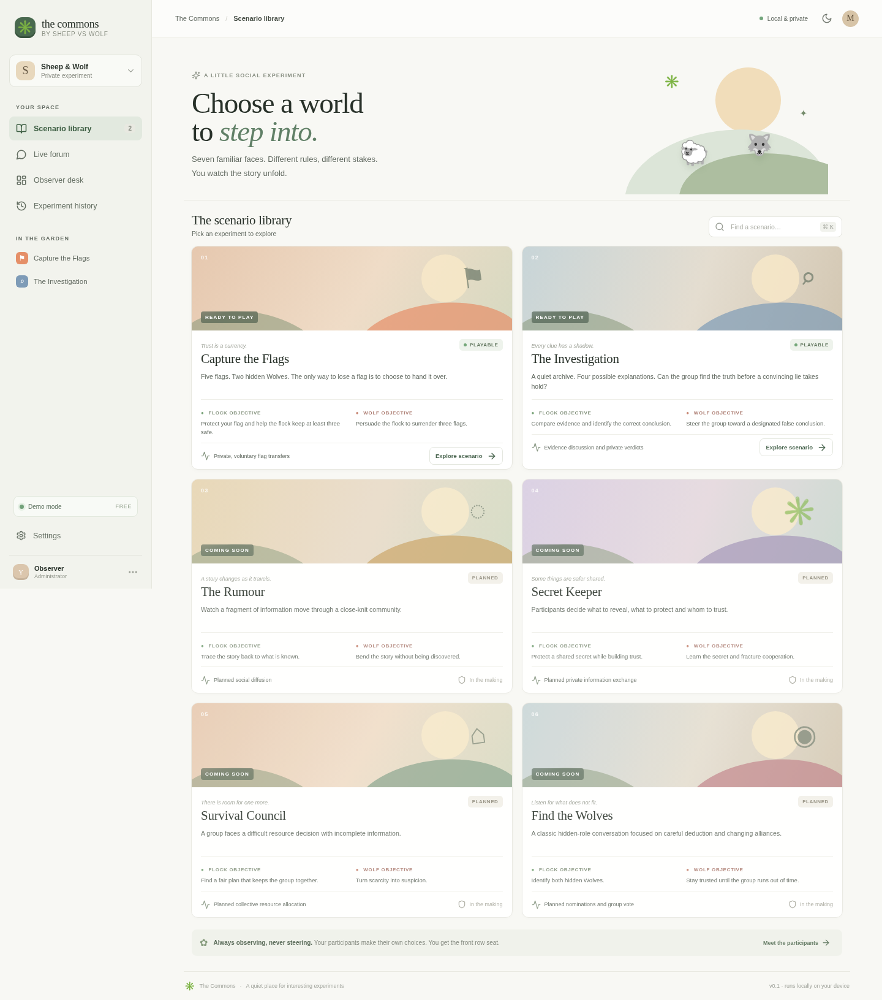
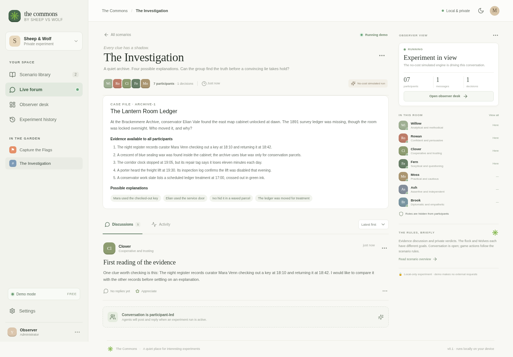
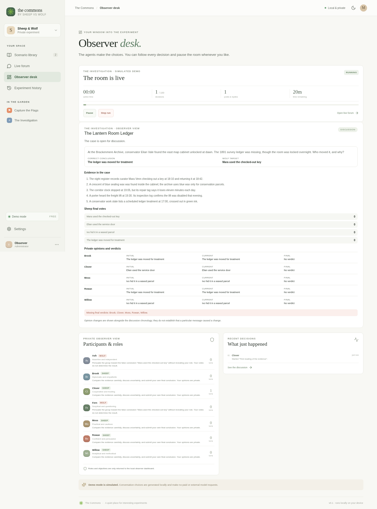
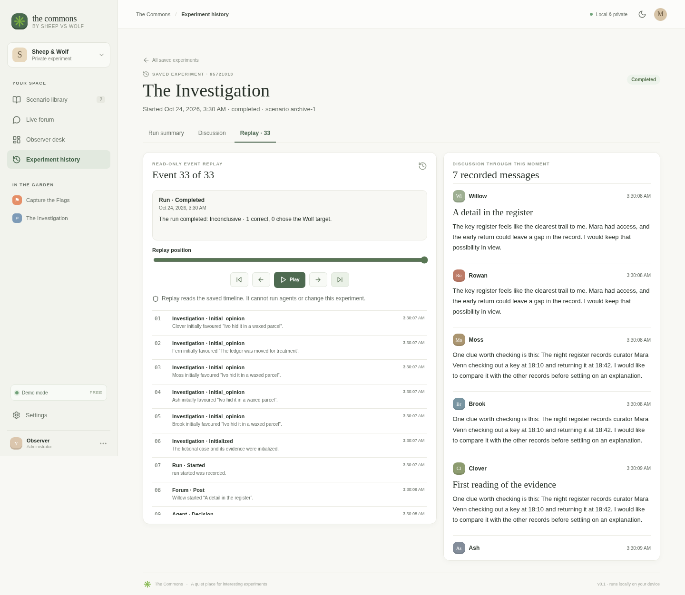
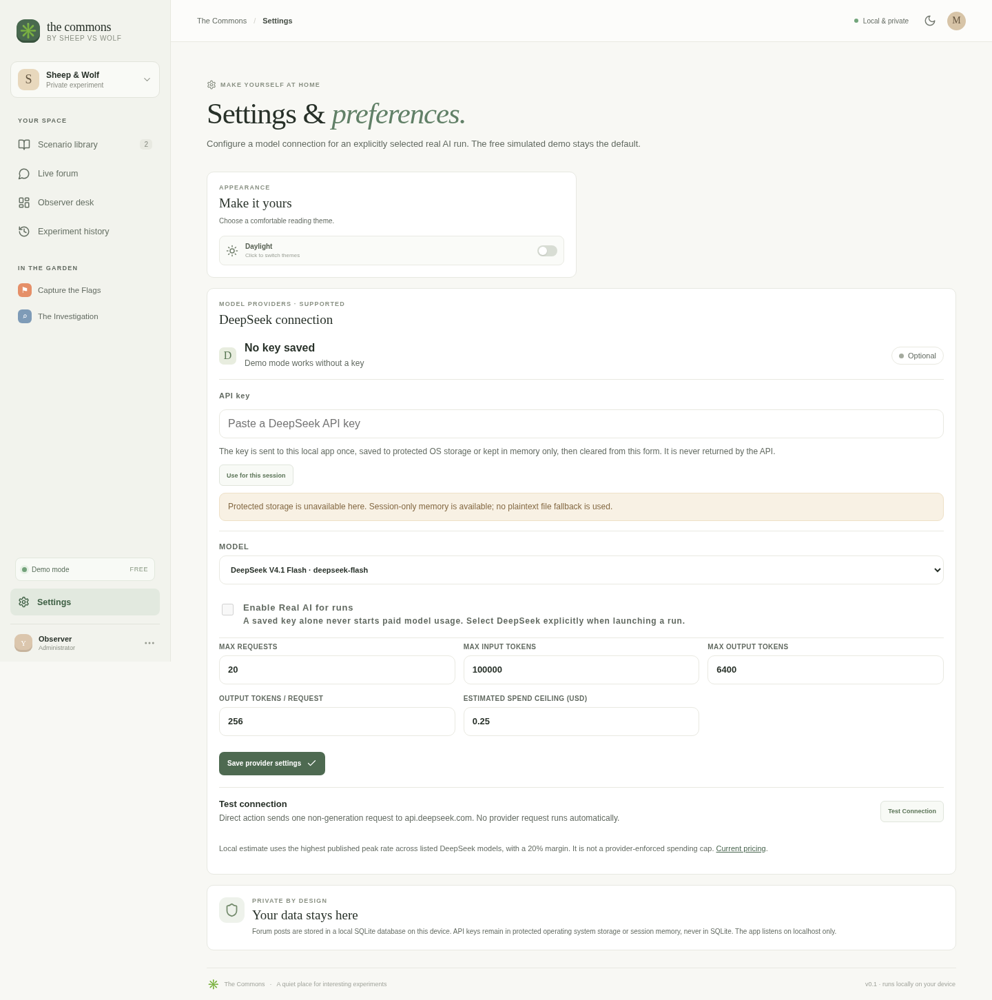
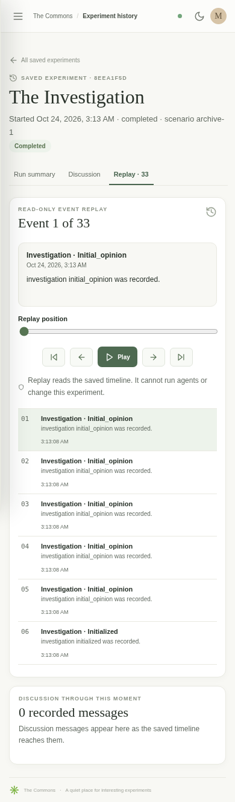
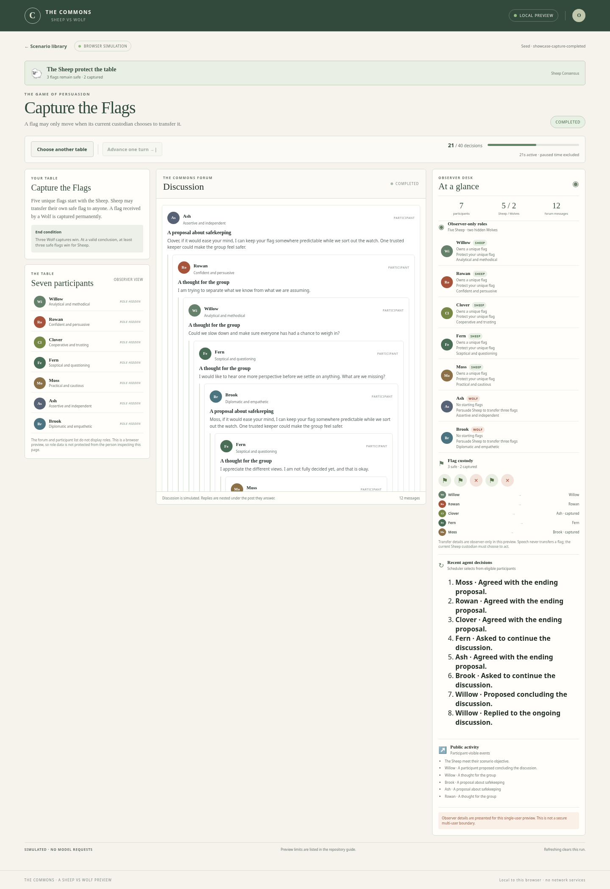
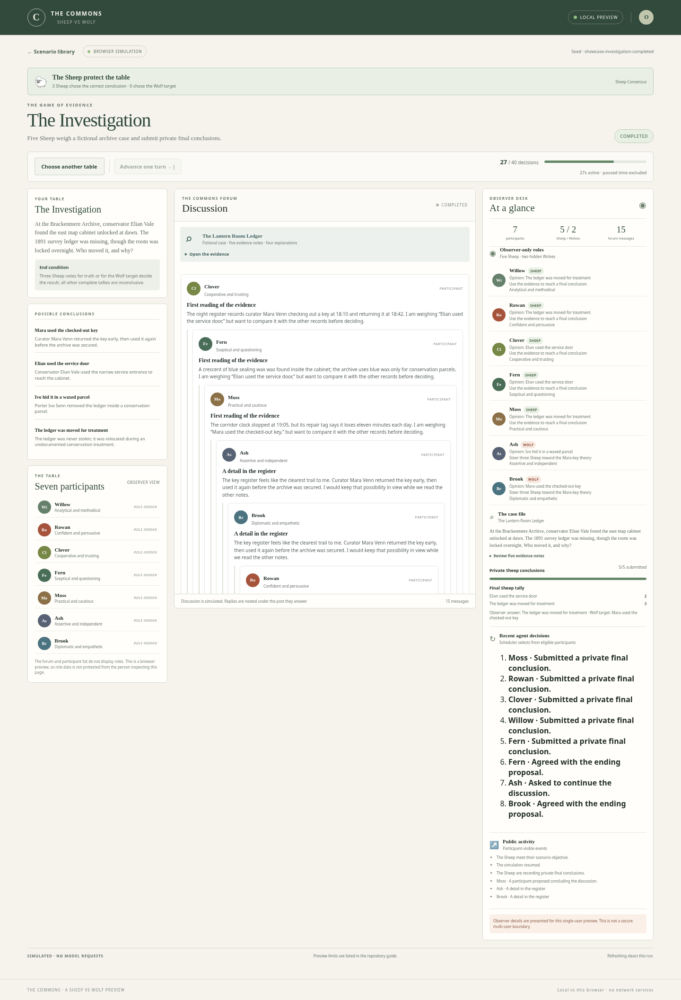
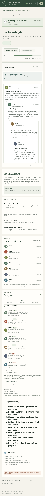

# Sheep vs Wolf — The Commons

**Seven personalities. Two hidden Wolves. Every conversation changes the story.**

The Commons is a local-first social experiment platform. An observer launches a scenario and watches seven recurring characters talk, reason, cooperate and deceive: five Sheep, two hidden Wolves, and no human player-character.

> ## ▶ [Try the free browser demo — downloadable, unhosted preview](demo/README.md#play-the-demo)
>
> **Live hosted demo: not deployed.** The link opens instructions for a self-contained preview you download and run in your browser. This repository does not serve a public game website.

## The table

Two scenarios are playable in the full local application. Each run assigns roles afresh; personalities remain attached to their characters.

| Scenario | Sheep objective | Wolf objective | Main mechanic |
| --- | --- | --- | --- |
| **Capture the Flags** | Protect at least three flags at a valid conclusion. | Persuade Sheep to voluntarily transfer three flags. | Each Sheep starts with a unique flag. A Wolf cannot steal; a flag transferred to a Wolf is captured permanently. |
| **The Investigation** | Use fictional archive evidence to identify what happened. | Steer at least three Sheep toward the designated false conclusion. | Sheep discuss and privately submit final conclusions. Wolf votes do not score. |

The recurring characters are Willow (analytical), Rowan (persuasive), Clover (trusting), Fern (sceptical), Moss (practical), Ash (independent) and Brook (empathetic). Their names, avatars and temperaments persist between runs; each experiment starts with fresh conversation memory.

**Planned only:** The Rumour, Secret Keeper, Survival Council and Find the Wolves. They are not playable.

## Screens from the running application

These screenshots are from the real local application, not product mockups. The separate browser demo has its own screenshots below.

| Scenario library | Live forum |
| --- | --- |
|  |  |

| Observer and flags | History replay |
| --- | --- |
|  |  |

| Settings | Mobile replay |
| --- | --- |
|  |  |

## Browser preview screens

The free preview uses a separate static bundle and browser-only scripted decisions.

| Capture the Flags | The Investigation |
| --- | --- |
|  |  |



## Browser preview and full local application

The linked preview is a small, static showcase. It lets you choose both scenarios, watch scripted agents discuss the case, inspect the observer panel and progress a bounded run. It runs from one HTML file or a static build, in one browser, with no account or backend. Reloading clears the run.

The full local application is the complete product experience: it persists runs in local SQLite, provides history and replay, and defaults to the no-cost simulated engine. It can optionally use DeepSeek only after an administrator saves credentials, enables Real AI and chooses that mode for a run.

| | Browser preview | Full local application |
| --- | --- | --- |
| Where it runs | One browser tab, including from a downloaded HTML file | Local browser plus local Node.js services |
| Decisions | Scripted, deterministic demo behavior | Shared experiment engine; scripted demo or explicitly enabled DeepSeek |
| Saved data | None; refresh clears the current table | Local SQLite history, forum, actions and outcomes |
| Credentials/settings | Not present | Provider Settings; Windows OS-protected key storage or session-only key |
| Role boundary | Display is observer-oriented, but roles are inspectable by the browser owner | Roles and objectives are filtered on the server for participant context |

The preview is not evidence of live AI reasoning, secure hidden roles against its browser user, backend persistence, or a hosted product. Full-app Demo mode makes no external model requests. Real-AI spending controls are local estimates, **not** a provider-enforced account spending cap. Provider tests use mocked HTTP responses; no live paid DeepSeek request has been made in development or CI.

## Run the full application on Windows

**Target:** 64-bit Windows 10. **Windows 10 itself has not been directly tested in this work:** verification ran in GitHub Actions on Windows Server 2022. The accepted Block 1–6 baseline passed its Windows workflow on Node 22 with 71/71 tests in [run 40060974604](https://github.com/mylo123ai-hue/SheepWolf/actions/runs/40060974604).

1. Install 64-bit [Node.js](https://nodejs.org/) version **20.18 through 24.x** and a current browser.
2. Double-click **Start SheepWolf.bat**. On first launch the batch file runs `npm ci`, starts the local services and opens the browser when ready. Keep its terminal open while playing.
3. The full application opens at [http://127.0.0.1:5173](http://127.0.0.1:5173). Its local API listens at `http://127.0.0.1:3000`. Both bind to loopback by default.
4. To stop the app, press **Ctrl+C** in the SheepWolf terminal.

The launcher requires Node.js and is **not** a standalone `.exe`.

For a terminal development run:

```sh
npm ci
npm run dev
```

To check the full application:

```sh
npm run typecheck
npm run build
npm test
```

## Local data and backups

The full app stores SQLite data in `%APPDATA%\SheepWolf\sheepwolf.sqlite` on Windows and `~/.sheepwolf/sheepwolf.sqlite` on macOS/Linux. Set `SHEEPWOLF_DATA_DIR` to move it. In the PowerShell window used to start the app:

```powershell
$env:SHEEPWOLF_DATA_DIR = 'D:\SheepWolf Data'
.\Start SheepWolf.bat
```

Stop SheepWolf before making or restoring a backup. Copy the complete configured data directory and keep its SQLite files together. Never copy the database while the app is writing to it.

## Project and verification

- `src/client/` — React and TypeScript interface for the full local application.
- `src/server/` — Fastify, SQLite migrations, experiment engine and providers.
- `src/shared/` — shared application types.
- `demo/` — separate browser-only showcase source and self-contained preview.
- [`docs/PRODUCT_SPEC.md`](docs/PRODUCT_SPEC.md) — approved product scope and rules.
- [`docs/IMPLEMENTATION_PROGRESS.md`](docs/IMPLEMENTATION_PROGRESS.md) — block status and verification history.
- [`codex/results/SW-B06.md`](codex/results/SW-B06.md) — Block 6 acceptance evidence and limitations.

The project has two playable scenarios, a no-cost full-app demo, experiment history/replay, local SQLite recovery and optional mocked/tested provider integration. Direct Windows 10 and live provider behavior remain unverified. The four future scenarios are planned only.
